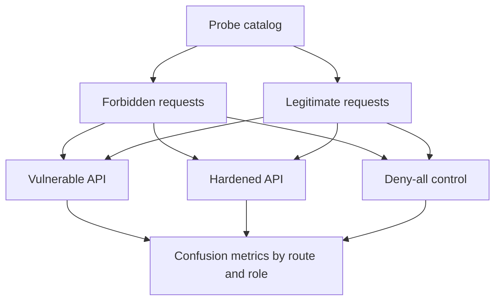
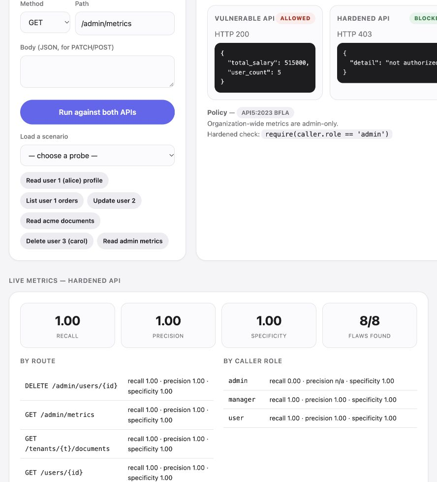

# AuthMatrix-Veritas

An API authorization test workbench that probes a seeded-vulnerable API, a hardened version, and a deny-all control to distinguish security failures from false denials.

[](https://github.com/harshacreate/AuthMatrix-Veritas/actions/workflows/ci.yml)

## Problem / why it matters

An API can authenticate a caller and still authorize access to the wrong object or function. Tests that only check whether forbidden requests are blocked can also make an API that denies every request look secure. This workbench includes legitimate probes so that false denials affect the evaluation.

## What I built

The same route set is represented by a seeded-vulnerable FastAPI app, a hardened app, and a deny-all control. An in-process probe catalog sends forbidden and legitimate requests, records responses, and computes recall, precision, and specificity overall and by route/role.



### Dashboard



## Results / evaluation

**CONTROLLED FIXTURE evaluation, not a real service.** Measured with `python3 -m authz_tests.runner` across 19 probes:

| Implementation | Recall | Precision | Specificity | Interpretation |
|---|---:|---:|---:|---|
| Vulnerable | 0.00 | n/a | 1.00 | All 8 seeded flaws were found by the suite; the app itself allowed all 10 forbidden probes. |
| Hardened | 1.00 | 1.00 | 1.00 | Denied 10 forbidden probes and allowed 9 legitimate probes. |
| Deny-all control | 1.00 | 0.53 | 0.00 | Blocked every forbidden probe but also denied every legitimate probe. |

Tests: 9 passed. These values describe the bundled route fixtures and probe catalog only.

## Design decisions and lessons to discuss

- The metric treats a block as a positive prediction and a forbidden request as the positive label; the deny-all control demonstrates why recall alone is insufficient.
- Each probe uses a fresh in-process client, which makes the test deterministic but does not exercise network, gateway, session, or deployment behavior.
- The sample token is base64 of a username. It is intentionally not a security credential, so the exercise isolates authorization decisions rather than authentication design.
- The hardened app uses owner/admin checks, role checks, and a patch model that does not expose the role field. A next step is testing a documented external API contract without reusing real customer data.

## Run it

### Docker workbench

```bash
docker compose up --build
# Open http://127.0.0.1:8092
```

### Local tests and probe report

```bash
python3 -m venv .venv
source .venv/bin/activate
python -m pip install -r requirements.txt
make test
make run
make workbench  # optional local UI, 127.0.0.1:8070
```

For a manual local demonstration, `make serve-vuln` and `make serve-secure` run separate APIs on loopback. Keep the intentionally vulnerable app isolated and use only the bundled fixture data.

## Limitations & next steps

The apps are small in-memory fixtures with a deliberately trivial token scheme. The probe catalog covers a finite set of seeded BOLA, BFLA, tenant, and mass-assignment cases; passing it is not a general API security assessment. Next steps are adding property-based identifier/role combinations, contract-driven tests, and authorization policy tests against a separately isolated practice service.
